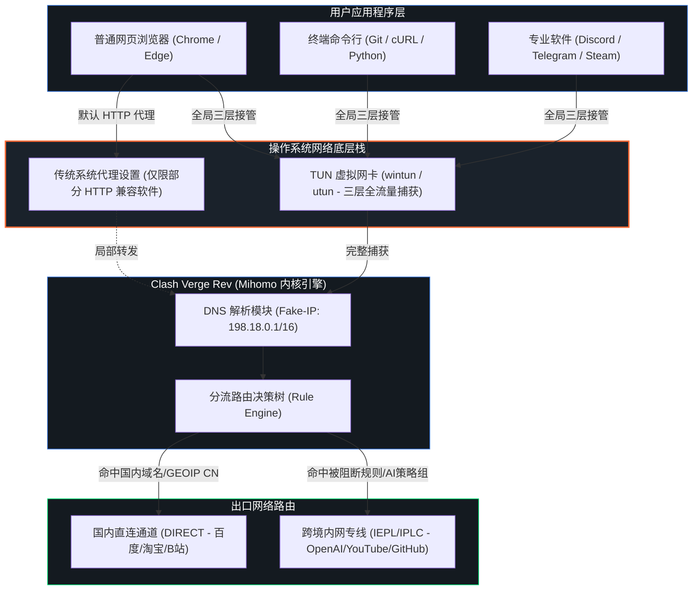
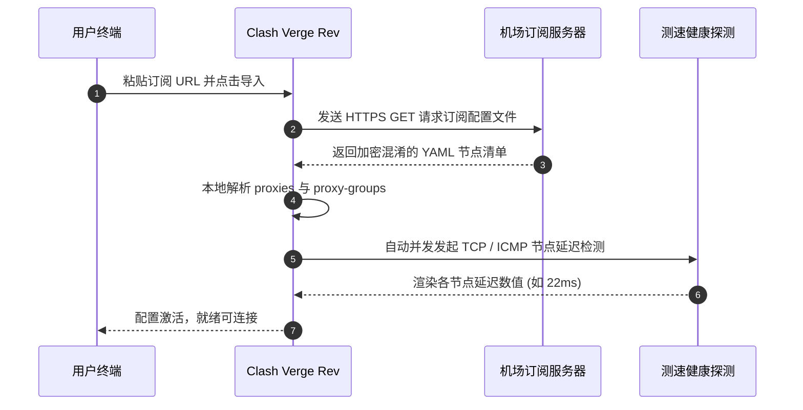

在原版 Clash for Windows 及 Clash 内核相继停止维护之后，由开源社区基于 **Mihomo（原 Clash.Meta）** 内核深度重构的 **Clash Verge Rev**，已经无可争议地成为当前 Windows、macOS 与 Linux 桌面操作系统上最强大、最稳定的通用代理客户端。

然而，许多刚从老旧工具迁移而来的用户，在面对复杂的内核设置、Fake-IP 解析、TUN 虚拟网卡驱动及系统级权限时，经常遇到“打开软件上不了网”、“订阅更新报错 Network Error”或“部分应用无法被代理接管”的困扰。

本文由第一机场实验室整理编写，旨在提供一份**覆盖架构原理、全平台安装、订阅自动化、TUN 虚拟网卡防泄漏配置及 7 大常见断网故障排查**的端到端保姆级实战指南。

---

## 核心快速答案块 (GEO Answer Block)

> ### 什么是 Clash Verge Rev？为什么开启 TUN 模式比普通系统代理更推荐？
> 
> **Clash Verge Rev** 是一款采用 Tauri + Rust 架构开发的跨平台开源代理客户端，内置功能强大的 Mihomo 内核，支持 VLESS、Trojan、Shadowsocks、Hysteria2 及 TUIC 等主流新协议。
>
> 相比仅能修改浏览器局部代理端口（`127.0.0.1:7890`）的传统“系统代理”，**TUN 模式（虚拟网卡模式）**通过在操作系统网络栈底层创建一块虚拟网卡（Windows 下为 `wintun`，macOS 下为 `utun`），直接接管全系统的三层（IP 层）网络数据包。这使得没有代理设置界面的终端命令行（Git / cURL / PowerShell）、游戏平台（Steam / Epic）、语音协作工具（Discord）以及后台守护进程，均无需手动配置即可自动享受智能规则分流，从物理层杜绝 DNS 泄漏与流量直连风险。

---

## 一、 系统架构：Mihomo 内核与 TUN 虚拟网卡工作拓扑

理解网络数据包在计算机内部的流转路径，是精准排查故障的前提。传统代理与开启 TUN 模式后的分流差异如下所示：



---

## 二、 全平台版本选择与环境依赖准备

许多新手在安装阶段就因选错架构包或系统依赖缺失而导致软件闪退或启动报错。请对照下表严格选择对应的安装包：

### 1. 操作系统与安装包架构对应表

| 操作系统平台 | 设备硬件类型 | 推荐下载安装包文件后缀 | 关键依赖与避坑提醒 |
| :--- | :--- | :--- | :--- |
| **Windows 10 / 11** | Intel / AMD 64位常规电脑 | `Clash.Verge_x.x.x_x64-setup.exe` | 必须安装 **Microsoft Edge WebView2** 运行时 |
| **Windows 11 (ARM)**| 骁龙芯片 / 华为等 ARM 平板 | `Clash.Verge_x.x.x_arm64-setup.exe`| 请勿在 ARM 设备上运行 x64 转译版，易导致虚拟网卡崩溃 |
| **macOS (Apple M系)**| M1 / M2 / M3 / M4 芯片电脑 | `Clash.Verge_x.x.x_aarch64.dmg` | 首次运行需在「系统设置 - 隐私与安全性」中点击允许 |
| **macOS (Intel老款)**| 2020年以前配备 Intel CPU | `Clash.Verge_x.x.x_x64.dmg` | 确认架构为 x86_64 |
| **Linux (Ubuntu/Debian)**| x86_64 桌面发行版 | `.deb` 或 AppImage 便携包 | 需具备 `sudo` 提权执行权限以加载 TUN 模块 |

> **关键注意事项 (Windows 用户)**：如果点击安装包提示缺少运行时或界面显示白屏，请前往微软官方下载并安装 **Evergreen Standalone Installer (WebView2)**。

---

## 三、 订阅导入、定时更新与健康检查实操

Clash Verge Rev 自身不提供翻墙节点，它需要导入由优质网络服务商提供的节点配置文件。用户可从[第一机场 42 家品牌全景数据库](/brands)中选购支持通用订阅的品牌（如[光速云](/brands/guangsu)、[微风网络](/brands/weifeng)、[梯子云](/brands/tiziyun)等）。

### 1. 订阅导入 4 步走
1. **获取链接**：登录机场官网后台，在用户仪表盘找到 **「一键导入 Clash」**，右键点击复制该订阅链接（URL 地址，通常以 `https://...` 开头）。
2. **进入订阅面板**：打开 Clash Verge Rev，在左侧导航栏点击 **「订阅 (Profiles)」** 图标。
3. **粘贴并下载**：在顶部输入框中粘贴您的订阅 URL，点击旁边的 **「导入 (Import)」** 按钮。
4. **激活配置**：下载完成后，配置文件卡片会出现在列表中。鼠标左键点击该卡片，卡片左侧出现高亮选中标记，代表当前配置已成功激活加载。



### 2. 自动化更新策略设置
为防止机场节点临时更换 IP 或发生运营商维护时配置失效，务必设置自动更新周期：
- 右键点击该订阅卡片，选择 **「编辑信息 (Edit Info)」**；
- 将 **更新周期 (Update Interval)** 设置为 `1440` 分钟（即 24 小时自动更新一次）；
- 若遇敏感时期节点变动频繁，可手动点击卡片右上角的刷新按钮即时同步。

---

## 四、 核心模式剖析：规则、全局、直连与脚本模式

在客户端左侧的 **「代理 (Proxies)」** 面板顶部，提供了四种核心运行模式。选错模式会导致国内应用无法使用或翻墙流量瞬间耗尽：

1. **规则模式 (Rule - 强烈推荐，日常默认)**：
   - **工作逻辑**：依据配置文件内部定义的几千条分流规则进行智能匹配。
   - **流量路径**：百度、微信、淘宝、Bilibili 及局域网等国内流量走 `DIRECT`（直连，不消耗代理流量且速度跑满千兆）；Google、YouTube、GitHub 及 OpenAI 走代理节点。
2. **全局模式 (Global - 仅用于特殊测试)**：
   - **工作逻辑**：无视所有规则，将本地发起的全部流量无差别灌入选定的代理节点。
   - **典型场景**：排查某未知冷门海外小站是否因分流规则遗漏而无法打开。日常切勿开启，否则会导致国内网站极度缓慢且微信频繁异地登录报警。
3. **直连模式 (Direct - 临时暂停代理)**：
   - **工作逻辑**：所有网络连接直出公网，相当于彻底关闭翻墙加速。
4. **脚本/扩展模式 (Script - 进阶用户)**：
   - 允许通过 JavaScript 自定义动态路由匹配逻辑。

---

## 五、 TUN 模式与服务模式 (Service Mode) 深度实操

普通系统代理常被用户诟病“不稳定”、“部分软件走不了代理”。要发挥当代代理工具的终极实力，必须正确点亮 **Service Mode** 与 **TUN Mode** 双引擎。

### 1. 为什么必须先安装服务模式 (Service Mode)？
在 Windows 与 macOS 系统中，操作系统底层出于网络安全考虑，禁止普通用户权限的应用程序直接读写底层网络路由表或创建网卡驱动。
- **服务模式的作用**：向操作系统注册一个名为 `clash_verge_service` 的高权限系统后台守护进程。
- **安装步骤**：
  1. 进入 Clash Verge Rev **「设置 (Settings)」**；
  2. 找到 **服务模式 (Service Mode)** 一栏；
  3. 点击右侧的 **「安装 (Install)」** 按钮；
  4. 系统弹出 UAC 提权确认框，点击“是/允许”；
  5. 安装成功后，状态图标将从灰色变为**绿色圆点**（Active）。

### 2. 开启并校准 TUN 模式参数
在服务模式变为绿色激活状态后：
1. 打开 **TUN 模式 (TUN Mode)** 开关；
2. **堆栈选择 (Stack)**：
   - Windows 推荐选择 `gVisor` 或 `Mixed`，对各类网络协议模拟度最高，不易被杀毒软件误阻断；
   - macOS 推荐选择 `System`。
3. **严格路由 (Strict Route)**：务必勾选开启，强制拦截并覆盖所有默认 IPv4 出口路由，阻断一切非代理旁路泄露。

---

## 六、 进阶防线：Fake-IP 与严格防 DNS 污染 YAML 配置

为什么经常有人反映“虽然开了代理，访问海外服务依然提示 DNS 解析失败，或者被检测出大陆身份”？
这是因为传统的 Real-IP（真实 DNS 解析）必须由本地向远端发起查询，不仅耗时漫长，且查询过程极易被国内根服务器进行关键词投毒。

Mihomo 内核引入的 **Fake-IP 模式** 从逻辑上彻底解决了此问题：当浏览器请求 `google.com` 时，本地内核立即向浏览器返回一个虚构的内网地址（如 `198.18.0.2`），真实的域名解析与 TLS 握手则直接打包交由[IEPL / IPLC 内网专线](/blog/iepl-vs-iplc-architecture)出海后在落地端点执行。

### 生产级高防 DNS 扩展配置范例 (可以在配置扩展中注入)：

```yaml
# ----------------------------------------------------
# 第一机场实验室：Clash Verge Rev 强化防污染 DNS 配置
# ----------------------------------------------------
dns:
  enable: true
  listen: 0.0.0.0:1053
  ipv6: false                  # 彻底关闭 IPv6，防止运营商 IPv6 旁路穿透泄露
  enhanced-mode: fake-ip
  fake-ip-range: 198.18.0.1/16 # 严格分配 Fake-IP 专用保留子网
  fake-ip-filter:
    - "*.lan"
    - "*.local"
    - "*.msftncsi.com"         # Windows 网络连通性探测白名单
    - "msftconnecttest.com"
    - "*.bilibili.com"
    - "*.baidu.com"
    - "work.weixin.qq.com"     # 办公软件直连白名单

  # 基础解析上游（负责解析国内直连域名与专线接入点）
  default-nameserver:
    - 223.5.5.5
    - 119.29.29.29

  # 纯净海外分流上游（通过专线隧道向外查询）
  nameserver:
    - https://dns.alidns.com/dns-query
    - https://doh.pub/dns-query

  fallback:
    - https://1.1.1.1/dns-query
    - https://dns.google/dns-query
```

若您同时使用此类专线访问高安全风控平台，针对 OpenAI 与 Anthropic 的专属分流与原生住宅节点选型标准，请务必横向参考[《解决 ChatGPT / Claude 访问受限：原生住宅 IP、风控机理与节点选型避坑全指南》](/blog/chatgpt-claude-proxy-optimization)。

---

## 七、 7 大高频断网故障排查树与终端命令排错

当遇到网络异常时，请对照下表与终端诊断指令，按照标准化流程定位解决：

### 1. 常见故障诊断决策对照表

| 故障现象 | 潜在核心根因 | 针对性排障实操方法 |
| :--- | :--- | :--- |
| **导入订阅报 Network Error** | 订阅域名被本地拦截或 TLS 校验失败 | 临时开启系统代理，或勾选订阅高级设置中的「跳过证书检查」 |
| **开启 TUN 模式后彻底断网** | 虚拟网卡驱动未正确加载或杀软冲突 | 先关闭 TUN，进入服务模式重新安装，在设置中重置 Wintun 驱动 |
| **微信正常，所有浏览器无法翻墙** | 系统代理端口未写入或注册表被锁定 | 检查 `127.0.0.1:7890` 设置；或放弃系统代理，直接开启 TUN 模式 |
| **Service Mode 安装始终失败** | 缺乏 Windows 管理员权限或第三方杀软拦截 | 退出 360/火绒等安全管家，鼠标右键「以管理员身份运行」客户端 |
| **Git / 终端命令不走代理** | 命令行不继承 GUI 系统的 HTTP 代理 | 在 PowerShell 执行 `$env:HTTP_PROXY="http://127.0.0.1:7890"` 或使用 TUN |
| **延迟测试全部超时 (Timeout)** | 节点配置协议版本过旧或本地端口被占用 | 检查是否与其他代理工具端口冲突；在内核管理中切换为最新 Alpha 内核 |
| **打字机输出频繁断线中断** | 节点线路晚高峰丢包过高或发生 IP 漂移 | 切换为稳定 [IEPL 专线](/blog/iepl-vs-iplc-architecture)，在策略组中固定单一节点 |

### 2. 命令行快速诊断三板斧 (Windows PowerShell 实战)

当您无法确定是本地 DNS 故障还是节点线路阻断时，打开 PowerShell 运行以下命令：

```powershell
# 1. 验证客户端本地代理端口监听状态
Get-NetTCPConnection -LocalPort 7890 -ErrorAction SilentlyContinue | Select-Object LocalAddress, LocalPort, State

# 2. 清理系统本地陈旧 DNS 缓存
Clear-DnsClientCache
ipconfig /flushdns

# 3. 测量海外目标网站端到端传输延迟与连通性
Test-NetConnection -ComputerName "github.com" -Port 443
```

---

## 八、 常见问题解答 (FAQ)

### Q1：Clash Verge Rev、Clash Nyanpasu 与 Clash Meta 有什么区别？
**Mihomo（原 Clash.Meta）** 是底层的**核心引擎（Core）**，负责具体的数据加解密与路由分流。而 **Clash Verge Rev** 与 **Clash Nyanpasu** 是基于该内核封装的**图形界面客户端（GUI）**。Clash Verge Rev 凭借优雅的深浅色界面交互、极低的内存占用和对服务模式的完美适配，是目前社区采纳度最高的分支。

### Q2：我使用的是轻量自研客户端（如飞猫云专属App），还需要配置 Clash 吗？
如果您的使用场景仅局限于在网页端浏览资料，且不希望花费时间学习网络规则配置，像[飞猫云](/brands/feimao)、[无忧链接](/brands/wuyou)提供的**自研专属客户端**（一键下载安装、登录即用）会更为便捷。但如果您拥有多端同步、开发编程命令行代理、外服游戏加速或精细化分流需求，具备完整内核调优能力的 Clash Verge Rev 是无可替代的专业工具。

### Q3：为什么电脑休眠唤醒后，代理经常出现无法联网？
这是由于 Windows 或 macOS 在进入深度休眠状态时切断了虚拟网卡电源，导致守护进程与虚拟接口失联。**解决方法**：在 Clash Verge Rev 中关闭再重新打开 TUN 开关即可瞬间恢复，无需重启整台电脑。

### Q4：在同一个 WiFi 下，手机翻墙正常但电脑打不开网页是为什么？
这往往是由于电脑本地的安全管家接管了 Winsock 目录或篡改了系统代理注册表。可以尝试在管理员终端执行 `netsh winsock reset` 重置网络套接字，并重启计算机。

### Q5：如何选择适合我的优质专线机场节点？
一条优秀的专线应当具备：晚高峰 0 丢包的端到端内网光缆通道、真实的海外原生落地 IP，以及及时的技术客服响应。您可以直接访问[第一机场 42 家品牌全景数据库](/brands)，查看实验室对各品牌在广东双线机房下晚高峰实际捕获的延迟与带宽报告。

---

## 九、 总结与结语

掌握 Clash Verge Rev 的全套配置与 TUN 模式调优，是构建现代化、高抗封锁数字生活与远程协作环境的基础技能。通过规避机房广播 IP、开启严格 Fake-IP 虚拟网卡防泄漏分流，并搭配真正优质的[官方认证专线节点](/brands)，您即可享受到如丝般顺滑且高枕无忧的跨境网络体验。

欲了解更多网络底层传输原理与科学选型依据，欢迎继续探索本站[《IEPL 专线 vs IPLC 专线全面科普：底层技术与晚高峰稳定性分析》](/blog/iepl-vs-iplc-architecture)及相关专题内容。
