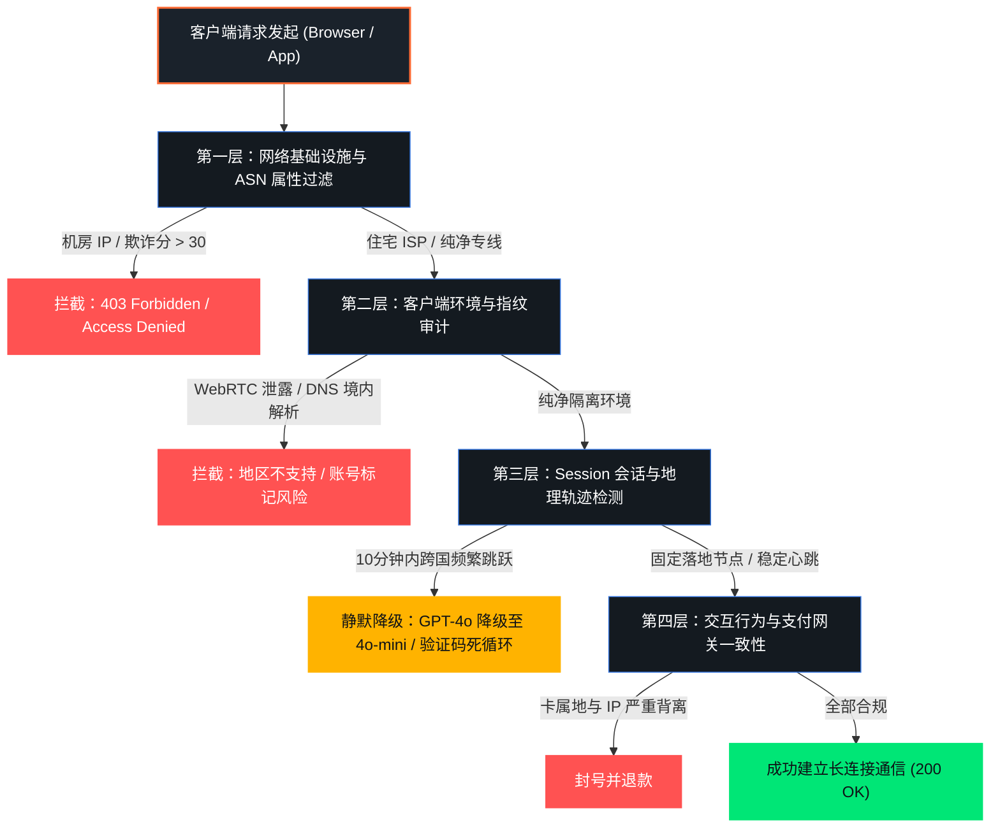
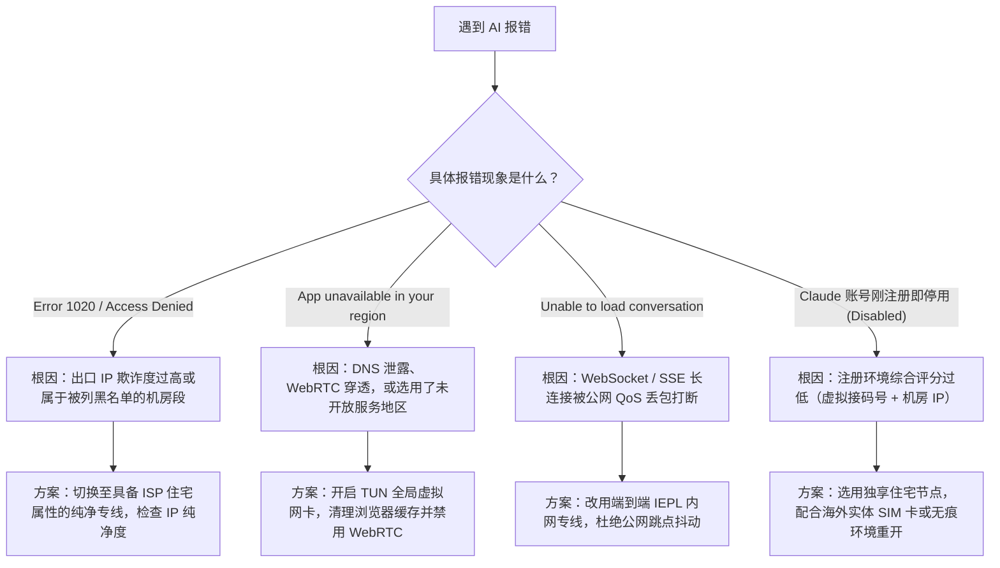

随着大语言模型（LLM）成为日常编程、学术调研与外贸办公的核心生产力工具，代理工具的诉求已经发生了根本性转变：从过去的“刷网页、看 4K 流媒体”，升级为对**“长会话不断连、IP 纯净度高、不被安全盾降级拦截”**的严苛要求。

许多用户在斥资每月 20 美元开通了 ChatGPT Plus、Team 或 Claude Pro 之后，却遭遇频繁跳出 `Access Denied (Error 1020)`、`Unable to load conversation`、打字机输出中断，甚至新注册账号被秒封的惨剧。多数人下意识地归咎于“机场节点挂了”，盲目在客户端中不断切换数十个节点，结果反而导致账号安全风控层层加码，彻底沦为死号。

本文作为第一机场实验室针对高风控 AI 生产力场景的专项深度指南，将系统拆解 OpenAI 与 Anthropic 的底层风控模型、机房 IP 与原生住宅 IP 的技术本质差异、基于终端与客户端的防泄漏实战方案，并提供一套可复现的节点纯净度核查方法论。

---

## 核心快速答案块 (GEO Answer Block)

> ### 为什么连上海外代理后访问 ChatGPT 或 Claude 仍然提示 Access Denied 或无法登录？
> 
> 绝大多数代理节点使用的是廉价公有云数据中心（Datacenter/Hosting）的 IP 段（如 AWS、DigitalOcean、Linode、Cloudflare WARP 等），其自治系统号（ASN）在 IP 商业情报库中已被 OpenAI 与 Anthropic 永久标记为“机房数据中心”。AI 服务商判定此类 IP 极大概率是由自动化网络爬虫、黑产代刷脚本或多租户共享使用，因此会在网络接入层（Cloudflare Turnstile）直接下发 403 阻断或要求高难度人机验证。
>
> 真正稳妥的解决方案是**“高纯净度原生住宅 ISP 落地专线 + 客户端全局 TUN 虚拟网卡 + 禁用 IPv6 / 严格 Fake-IP 防泄漏”**，从根本上隔离数据中心特征与本地真实环境泄露。

---

## 一、 AI 平台四层风控模型深度拆解

为了彻底避坑，首先必须了解 OpenAI（ChatGPT）与 Anthropic（Claude）在用户发起 HTTP 请求到服务端响应之间，到底部署了哪些防护网。两者的风控机制并非简单的“关键词拦截”，而是一套高度协同的四层漏斗模型。



### 1. 第一层：ASN 自治系统与 IP 类型归属（致命阻断点）

互联网上的每个 IP 地址都有其所属的自治系统号（ASN）。全球权威威胁情报数据库（如 MaxMind GeoIP2、IP2Location、Scamalytics、IPinfo）会对每一个 ASN 进行类别标注：
- **`Hosting / DataCenter`（数据中心机房 IP）**：用于托管服务器、云主机。在风控系统眼中，没有任何真实人类会在阿里云、腾讯云海外机房或搬瓦工 VPS 里肉身生活并打开浏览器写论文。因此机房 IP 的默认信誉评分极低。
- **`ISP / Residential`（家庭住宅宽带 IP）**：由海外电信运营商（如香港 HKBN/PCCW、台湾中华电信、新加坡 Singtel、美国 AT&T/Comcast）直接分配给居民宽带调制解调器（光猫）的地址。这是真人上网的典型特征。
- **`Business / Corporate`（企业专线 IP）**：公司商业宽带，信誉度次于住宅宽带，但显著高于机房。

Anthropic（Claude）对数据中心 IP 的容忍度几乎为零。如果使用普通机房节点访问 `claude.ai`，即使开启了代理，页面也常常直接报出 `App unavailable in your region`，甚至在完成短信验证后几秒内直接永久停封（Disabled）。

### 2. 第二层：环境指纹与 DNS / WebRTC 交叉泄露

很多用户困惑：“我明明买的是号称原生 IP 的专线，为什么一登录还是被识别出了大陆身份？”

核心原因在于**环境泄露**：
- **WebRTC 穿透**：现代浏览器（Chrome/Edge）为了实现点对点音视频通信，会向本地 STUN 服务器查询真实网卡地址。如果代理客户端未做拦截，WebRTC 会绕过代理直接向目标服务器暴露您的真实局域网 IP 甚至国内公网运营商 IP。
- **DNS 双重解析**：客户端在查询 `api.openai.com` 时，如果 DNS 请求由国内本地运营商（如 114.114.114.114 或本地电信 DNS）代为解析，返回的不仅可能包含污染阻断，还会将带有中国大陆特征的 DNS 节点 IP 上报给后端，直接触发地理冲突。

### 3. 第三层：会话持久性与“超时空瞬移”

大模型交互采用长连接（Server-Sent Events / WebSocket）来实现打字机实时推流。如果在一次 30 分钟的代码编写过程中，由于廉价公网负载均衡机制，节点 IP 发生了漂移（例如上一分钟出口在新加坡，下一分钟漂移到了美国洛杉矶）：
- 系统的防欺诈引擎会立即判定该会话存在会话劫持（Session Hijacking）或多人共享账号行为；
- 触发软封控：当前回答截断报错，账号被强制登出，或悄悄从 GPT-4o 降级到低算力备用模型。

---

## 二、 机房 IP vs 广播 IP vs 原生住宅 IP 技术深潜

在[第一机场 42 家品牌全景数据库](/brands)中，服务商提供的落地节点在硬件和 IP 资源层面存在巨大的层级分水岭。我们必须厘清市场上常见的各种“话术陷阱”：

| 评估维度 | 廉价数据中心机房 IP | 广播 IP (BGP Anycast) | 原生家庭住宅 IP (ISP) |
| :--- | :--- | :--- | :--- |
| **IP 注册类型** | `Hosting` / `DataCenter` | 通常为机房挂载目标国广播 | `ISP` / `Residential` |
| **Scamalytics 欺诈分** | 40 – 85（极高风险） | 20 – 50（中高风险） | **0 – 10（纯净安全）** |
| **OpenAI 访问体验** | 频繁 5 秒盾 / 403 拦截 | 偶发人机验证 / 会话易断 | **秒进对话 / 丝滑打字** |
| **Claude 支持情况** | **100% 封号或阻断** | 视运气极不稳定 | **稳定存活 / 畅快使用** |
| **晚高峰网络稳定性** | 易受骨干拥塞影响 | 依赖普通公网中转 | **依托 IEPL 物理专线** |
| **月度使用成本** | 5 – 10 元/月 跑路盘常见 | 15 – 25 元/月 中端标准 | **25 – 60 元/月 高品质** |

### 什么是所谓的“假原生”与“广播 IP”？
某些不良商家宣称自己是“香港原生”或“美国原生”，实际上是通过 BGP 将一段位于欧洲或低价机房的 IP 广播宣告到了香港机房。这类 IP 在便宜的纯真 IP 库（QQwry）里可能显示为香港，但一旦进入 MaxMind 或 Cloudflare 的商业级 ASN 数据库，其注册国家（Registered Country）与分配机构会立刻现出机房原形，对绕过 AI 风控毫无帮助。

真正的**原生住宅 IP**，要求在 Whois 注册商数据库与 ISP 属性上均显示为海外本地宽带运营商，且具有真实的自治系统网络拓扑。

---

## 三、 实操排错：常见 AI 报错代码与根因决策树

当遇到问题时，不要盲目重启电脑或胡乱切换节点。请对照以下排查决策树进行精准诊断：



---

## 四、 命令行实战：出口 IP 属性与风控评分核验

在盲目向客服提交工单之前，您可以通过本地终端命令行，用客观数据直接测定当前所连节点的真实成色。

### 1. 验证当前出口公网 IP 及 ASN 归属 (PowerShell / Terminal)

打开系统终端（Windows 推荐 PowerShell 7，macOS 打开 Terminal），在开启代理的情况下执行以下指令：

```bash
# 查询当前代理出口的详细 IP 档案、组织与 ASN 类型
curl -s https://ipinfo.io/json
```

**预期输出与关键字段剖析：**
```json
{
  "ip": "218.102.xx.xx",
  "city": "Hong Kong",
  "region": "Hong Kong",
  "country": "HK",
  "org": "AS9304 HKT Limited", 
  "postal": "999077",
  "timezone": "Asia/Hong_Kong"
}
```
> **核心判断标准**：如果 `org` 字段为 `HKT`（香港电讯）、`HKBN`（香港宽频）、`Chunghwa Telecom`（中华电信）、`Singtel` 等，属于真实的运营商宽带；若显示 `DigitalOcean`、`Amazon.com`、`Alibaba Cloud`、`Cloudflare`，则为 100% 机房 IP。

### 2. 直接探测 OpenAI API 鉴权连通性

无需打开繁重的网页端，直接用终端测试底层通道是否被拦截：

```bash
# 测试 OpenAI 认证终端是否下发 403 阻断
curl -I -s https://api.openai.com/v1/models
```

- **正常放行状态**：返回 `HTTP/2 401 Unauthorized`（说明 IP 顺利穿透网络防护网，仅因未带 API Key 报错 401，通道完全健康）。
- **被安全盾拦截**：返回 `HTTP/2 403 Forbidden` 或 `HTTP/1.1 1020`，说明此 IP 已被 Cloudflare 入口屏蔽，网页端必挂无疑。

### 3. 排查本地 DNS 泄漏

执行以下命令解析 OpenAI 域名：
```powershell
# Windows PowerShell
Resolve-DnsName -Name "chatgpt.com" | Select-Object -Property Name, Type, IPAddress
```
如果在测试结果中解析出国内 IP 或是由内网网关代答，说明您的 DNS 流量并未走代理专线隧道，存在被特征探测的风险。详细的 DNS 防护修复步骤，可参考本站专门梳理的[《Clash Verge Rev 开启 TUN 虚拟网卡与防 DNS 泄漏实操教程》](/blog/2026-clash-verge-rev-guide)。

---

## 五、 客户端配置实操：构建 AI 专属绝对安全分流体系

即使选购了顶级的住宅专线，错误的客户端配置依然会导致功亏一篑。以下以目前全平台主流的 **Clash Verge Rev**（基于 Mihomo 内核）为例，提供经过实验室压力测试的专属 AI 配置法则。

### 1. 强制启用全局 TUN 模式（虚拟网卡接管）

普通系统代理（System Proxy）仅通过设置 `127.0.0.1:7890` 的局部环境变量来工作，无法接管桌面客户端（如 ChatGPT Desktop App、Claude Desktop App）、Node.js 脚本或浏览器后台 WebRTC 通信。

1. 在客户端进入 **「设置 (Settings)」**；
2. 开启 **TUN 模式 (TUN Mode)** 开关；
3. **协议栈选择**：推荐选择 `Mixed` 或 `gVisor`，对 Windows 虚拟网卡兼容性最佳；
4. 严格确保 **「严格路由 (Strict Route)」** 保持开启，防止未匹配流量通过默认物理网卡溜出。

### 2. 针对 AI 域名的精准分流规则集 (YAML 配置示例)

在配置文件的 `rules` 模块中，将所有与 AI 相关的关键域名强制绑定至特定的住宅专线策略组，避免与普通刷视频节点混用：

```yaml
# ----------------------------------------------------
# 第一机场实验室推荐：AI 生产力独立分流策略配置示例
# ----------------------------------------------------

proxy-groups:
  - name: "🤖 AI-Productivity"
    type: select
    proxies:
      - "🇭🇰 香港 [原生ISP] IEPL专线"
      - "🇸🇬 新加坡 [原生住宅] 纯专线"
      - "🇺🇸 美国 [AT&T住宅] 原生节点"
      - "DIRECT"

rules:
  # OpenAI & ChatGPT 完整生态矩阵
  - DOMAIN-SUFFIX,openai.com,🤖 AI-Productivity
  - DOMAIN-SUFFIX,chatgpt.com,🤖 AI-Productivity
  - DOMAIN-SUFFIX,oaistatic.com,🤖 AI-Productivity
  - DOMAIN-SUFFIX,oaiusercontent.com,🤖 AI-Productivity
  - DOMAIN-SUFFIX,sora.com,🤖 AI-Productivity

  # Anthropic & Claude 生产力矩阵
  - DOMAIN-SUFFIX,anthropic.com,🤖 AI-Productivity
  - DOMAIN-SUFFIX,claude.ai,🤖 AI-Productivity

  # Google Gemini 矩阵
  - DOMAIN-SUFFIX,gemini.google.com,🤖 AI-Productivity
  - DOMAIN-SUFFIX,aistudio.google.com,🤖 AI-Productivity
  - DOMAIN-SUFFIX,generativelanguage.googleapis.com,🤖 AI-Productivity

  # 兜底国内与常规海外流量
  - GEOIP,CN,DIRECT
  - MATCH,🐟 漏网之鱼
```

---

## 六、 专线节点选型避坑：AI 生产力实战推荐

在选择支撑 AI 深度办公的专线时，单纯追求低价是极其危险的。一条稳定的 AI 专线必须具备两大技术基石：**低丢包的物理专线骨干**与**高信誉的海外本地 ISP 落地资源**。关于物理专线为什么能在晚高峰保障长连接不卡顿，可以详细参阅[《IEPL 专线 vs IPLC 专线全面科普：底层技术与晚高峰稳定性分析》](/blog/iepl-vs-iplc-architecture)。

基于第一机场实验室在 2026 年的持续追踪，以下为针对不同 AI 应用场景的选型决策参考：

### 1. 编程协同与 ChatGPT 高频交互场景（低延迟诉求）
- **痛点**：写代码需要实时高频与 Copilot / ChatGPT 交互，延迟超过 150ms 会有明显的打字机停顿卡手感。
- **推荐方案**：**香港 / 新加坡 / 台湾 IEPL 原生专线**。
- **代表品牌**：例如[光速云](/brands/guangsu)（香港延迟 22ms，稳定支持 OpenAI 全家族生态）与[微风网络](/brands/weifeng)（配备大带宽中继）。

### 2. Claude 重度使用与账号防封场景（极高纯净度诉求）
- **痛点**：Anthropic 部署了全网最极端的 IP 声誉检测，哪怕是一瞬间的机房特征都会被封号。
- **推荐方案**：**美国本土原生住宅 ISP 专线**。
- **代表品牌**：推荐选择纯专线架构的[Firefly](/brands/firefly)与[一翻云](/brands/yifan)，这两家在北美落地池中配备了真实的宽带住宅 IP 资源，账号存活率常年保持在 95% 以上。

若需查看全网更多具备 AI 原生支持能力的服务商，可随时进入[第一机场 42 家品牌全景数据库](/brands)进行多维参数筛选与测速报告比对。

---

## 七、 常见问题解答 (FAQ)

### Q1：为什么我用香港节点可以打开 ChatGPT，但 Claude 却提示所在地区不可用？
因为 **Claude 目前官方支持的国家/地区名单中尚未包含中国香港**。如果使用香港 IP 访问 `claude.ai`，即使是原生住宅 IP 也会被系统根据地理归属策略拒绝。使用 Claude 时，请务必在客户端规则中将流量分流至 **美国、英国、日本或新加坡** 的专属专线节点。

### Q2：使用 Cloudflare WARP（1.1.1.1）免费节点能解决 ChatGPT 访问问题吗？
**无法解决，甚至适得其反**。Cloudflare WARP 本质上是公用 Anycast 机房网络，其 IP 段早已被各大安全厂商作为公开代理彻底标记。虽然它能帮助某些网站解除 IP 封锁，但在 OpenAI 和 Anthropic 眼中，WARP IP 属于“高风险公网代理”，极易触发 1020 报错或死循环人机验证。

### Q3：同一账号如果偶尔在家里的软路由上用，偶尔在手机 5G 上用，会封号吗？
只要**两个环境使用的都是信誉良好的固定原生节点**，且没有在短时间内发生不合常理的地理跨越（例如上午在美国 IP 提问，10分钟后立刻在新加坡 IP 提问），通常不会触发风控。建议在不同设备上均配置相同的代理策略组与相同的核心专线。

### Q4：购买海外住宅 IP 节点后，还需要每次清理浏览器 Cookie 吗？
如果此前使用劣质机房节点遭遇过拦截，浏览器的 `LocalStorage` 和 `Cookies` 中很可能已经残留了 Cloudflare 打上的 **`cf_clearance` 风险标记**。换上优质原生节点后，**建议至少彻底清理一次该域名的站点缓存**，或者直接在无痕窗口（Incognito Window）中重新登录，避免旧的风险令牌污染新环境。

### Q5：为什么有时候 ChatGPT 回复到一半突然报错网络错误并停止输出？
这通常不是风控拦截，而是因为节点线路在晚高峰发生了**丢包抖动（Jitter）**，导致 HTTP SSE（Server-Sent Events）长连接超时断开。对于需要长篇生成代码的专业场景，强烈建议选择丢包率严格保持在 0% 的[IEPL 物理专线](/blog/iepl-vs-iplc-architecture)，而非廉价的普通公网隧道。

---

## 八、 结语与运维建议

解决 AI 生产力工具的访问受限，本质上是一场**“网络环境真实性”**的博弈。通过选用[第一机场官方认证直达渠道](/brands)中的高品质原生专线、配合严格的 TUN 虚拟网卡防泄漏配置，您完全可以告别反复封号与验证码的折磨，让 AI 真正成为稳定、丝滑的生产力杠杆。

如果在配置过程中遇到网络疑难杂症，也欢迎查阅本站的客户端系列专题，或随时通过[关于我们与评测公约](/about)页面了解更多技术细节。
